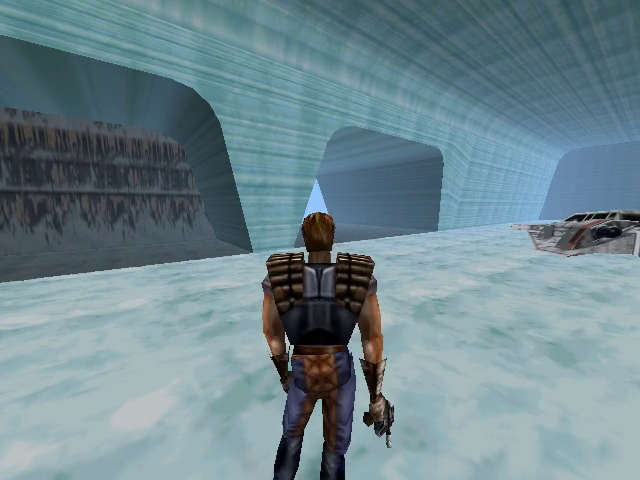
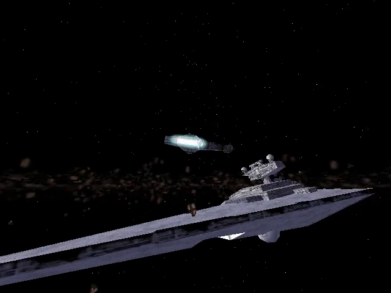
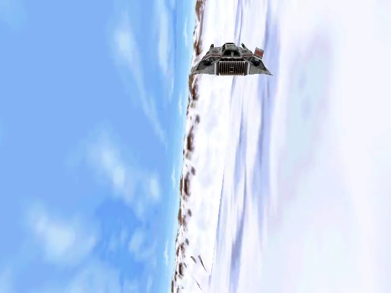
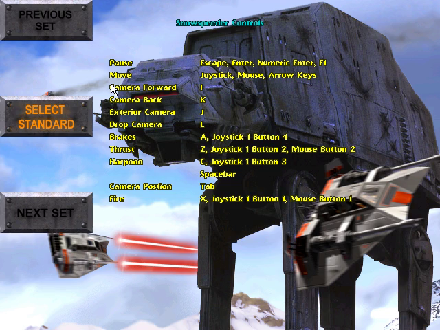

# Shadows of the Empire — static recompilation

The 1997 PC release of *Star Wars: Shadows of the Empire*, recompiled from its
x86 machine code to C with [pcrecomp](https://github.com/sp00nznet/pcrecomp)
and run on a 32-bit host, with a new controls layer: XInput gamepads with a
proper analog stick, a mouse that steers and aims by how it moves, and every
action on a sensible button.

It runs LucasArts' own code, recompiled; it is not a remake. **Generated source
is not distributed.** You supply your own copy of the game (Steam), and the
lifted C is generated on your machine.

This is part of the pcrecomp family and follows its shared house style
(layout, CLI, harness, headless mode).

## Status

**v0.1.0-dev, alpha. The whole game lifts (2,806 functions, 0 errors), boots,
renders its menus, cinematics and 3D, and the first level plays.**

| Part | State |
|---|---|
| SteamStub 3.x removed statically | works (pcrecomp `steamstub.py`, 3.x added for this game) |
| Lift | 2,806 functions, 0 errors, ~2 million lines of C |
| Host (`sote.exe`, 32-bit, pcrecomp `native32`) | 109 imports: 97 to real Windows, 12 shimmed |
| Launcher, title, level select | runs |
| Opening cinematic | runs, with subtitles |
| 3D (Steam's ddraw-to-Direct3D 9 wrapper) | renders; needed a lift fix (`fst st(i)`, [bringup](docs/bringup.md) 5) |
| Battle of Hoth (snowspeeder) | flies; steering, pause menu and its CONTROLS page work |
| Controls layer | gamepad, mouse and menu keys work under scripted input; a real pad not yet tried |
| Headless (`--headless --record`) | works |
| Later levels, saving, music | not tried |

## Screenshots

From headless runs of the recompiled game.

| | |
|---|---|
|  |  |
|  |  |

## Getting Started

You need *Star Wars: Shadows of the Empire* from Steam, installed (Steam app
560170), about 2 GB free, and Windows 10 or 11.

### Quick start

1. Download this repo (Code > Download ZIP) and unpack it anywhere.
2. Double-click **`Setup.cmd`**. It checks for Python, the pcrecomp toolkit,
   Visual Studio's C++ tools, CMake and Ninja, and asks before installing
   anything. It finds your Steam install, copies the game into `game\`,
   removes SteamStub, writes the game's settings, and lifts and builds. The
   build takes 15 to 45 minutes the first time. Everything it does goes to
   `setup.log`.
3. Double-click **`Shadows of the Empire (recomp).cmd`**.

If a step fails, it says what to do in one sentence; run `Setup.cmd` again and
it carries on where it stopped.

### Step by step

Prerequisites: Python 3.10+ (`py -3`), `pip install pefile capstone
cryptography`, Visual Studio 2022 or its Build Tools with "Desktop development
with C++", CMake 3.20+, Ninja, git.

```
git clone https://github.com/sp00nznet/pcrecomp ..\tools
```

The toolkit needs two changes this game brought (SteamStub 3.x, and the
`fst st(i)` lift fix); until they are merged, use the
`work/shadows-integration` branch. `Setup.cmd` checks for both.

1. Copy your Steam install (the folder with `Sdata\Shadows.exe`) to `game\`.
2. Remove SteamStub:
   ```
   py -3 ..\tools\tools\drm\steamstub.py game\Sdata\Shadows.exe game\Sdata\Shadows.unwrapped.exe
   SteamStub 3.x: app 560170, header 0x008F6220
     .text 0x00401000+0xB7200 decrypted (AES-256-CBC); OEP 0x004AE550
   ```
3. Write the game's settings to HKCU: the values are in `tools\setup.ps1`,
   step 4 (Steam writes them to HKLM on first launch, which needs an
   administrator; the host reads them from HKCU).
4. Catalog the functions (about 3 minutes):
   ```
   py -3 ..\tools\tools\disasm\disasm32.py game\Sdata\Shadows.unwrapped.exe -o work\functions.json
   [*] Functions: 2806  (thunks=10, leaves=653)
   [*] Byte coverage: 729,337 / 750,080 (97.2% of code range)
   ```
5. Lift (about a minute):
   ```
   py -3 run_lift.py --all
     lifted 2806   not-lifted stubs 0   errors 0   no terminator 8
   ```
6. Build: `build.cmd` (needs `-DPCRECOMP=..\tools` in `CMAKE_ARGS` if the
   toolkit is not in `work\pcrecomp`).
7. Run: `build\sote.exe --run`.

Usual trip-ups: `python` opening the Microsoft Store (use `py -3`); a new
`PATH` not seen until you open a new window; a 64-bit compiler environment
(`build.cmd` sets up the x86 one itself).

## Usage

```
build\sote.exe --run                      play
build\sote.exe --run --play               skip the launcher dialog (presses Play)
build\sote.exe --run --headless --mute --record out.mp4 --watchdog 120
                                          no window, nothing on screen, a video of it
build\sote.exe --pad-selftest             check the stick shaping
```

Controls, the button table and `controls.ini`: [docs/controls.md](docs/controls.md).
The whole command line and the debug switches: [docs/host.md](docs/host.md).

## Building from source

`py -3 run_lift.py --all` then `build.cmd`, or on the lab farm
`netlab build shadows` (recipe `local/projects/shadows.env` in recomp-netlab).
The generated C lands in `src/recomp/gen/` and is never committed.

## Documentation

- [docs/RECON.md](docs/RECON.md): what is in the Steam install, measured.
- [docs/bringup.md](docs/bringup.md): every wall so far and what fixed it.
- [docs/host.md](docs/host.md): the host's parts and command line.
- [docs/controls.md](docs/controls.md): how the game reads input, and the new controls.

## License

MIT for the code in this repository ([LICENSE](LICENSE)). *Star Wars: Shadows
of the Empire* is © Lucasfilm Ltd.; none of its files, and nothing generated
from them, is in this repository.
